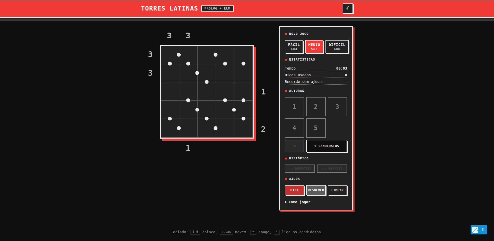

# Torres Latinas

## 1. Identificação

| Nome completo                   | Matrícula | Turma (14h/16h) | Usuário GitHub   |
| ------------------------------- | --------- | --------------- | ---------------- |
| Magno Luiz Vale Vieira          | 180042696 | 16h             | @magnluiz        |
| Maciel Ferreira Custodio Junior | 190100087 | 16h             | @macieljuniormax |
| Eduardo Belarmino Silva         | 221008580 | 16h             | @eduard0803      |

- **Nome do projeto:** Torres Latinas
- **Nome do grupo:** Torres Latinas
- **Repositório:** [torres-prolog-elm](https://github.com/magnluiz/torres-prolog-elm)
- **Commit ou tag entregue:** v1.0
- **Ponto de partida:** Remix original
- **Slides da apresentação oral:** Não há

## 2. Resumo

O Torres Latinas é um jogo de lógica executado no navegador, voltado para pessoas que gostam de desafios e quebra-cabeças. O objetivo é preencher uma grade com alturas de prédios, respeitando as regras de quadrado latino, visibilidade e pontos entre casas vizinhas. O Prolog é responsável por representar as regras como restrições lógicas, gerar puzzles com solução única, resolver tabuleiros e fornecer dicas ao jogador. A interface é desenvolvida em Elm, enquanto o Python realiza a comunicação entre o frontend e o Prolog.



## 3. Como executar

**Requisitos**:

- SWI-Prolog 11.0.0
- uv 0.13.9
- Python 3.14.10, instalado pelo uv
- Node.js 20.20.0
- GNU Make

**Instalação e execução:**

```sh
make install
make dev
```

**Testes:**

```sh
make test
```

**Testado em:** Navegador

## 4. Arquitetura

```text
  Navegador (Elm)
      │ HTTP/JSON
      ▼
  FastAPI (Python)
      │ janus-swi, chamada embutida
      ▼
  SWI-Prolog
```

| Parte      | Responsabilidade                                                     | Arquivos principais                                                                                       |
| ---------- | -------------------------------------------------------------------- | --------------------------------------------------------------------------------------------------------- |
| Prolog     | Define as regras, resolve e gera puzzles e produz dicas              | `backend/prolog/torres.pl`, `backend/prolog/explicador.pl`                                                |
| Python     | Valida o formato dos pedidos HTTP e encaminha as chamadas ao Prolog  | `backend/app/main.py`, `backend/app/prolog.py`                                                            |
| Elm        | Mantém o estado da partida, validações visuais e interface           | `frontend/src/Main.elm`, `frontend/src/Towers.elm`, `frontend/src/Api.elm`, `frontend/src/Statistics.elm` |
| JavaScript | Inicializa o Elm e lê e grava tema e recordes no armazenamento local | `frontend/src/main.js`                                                                                    |

## 5. Parte em Prolog

### 5.1 Predicados principais

| Predicado                                                                                                           | Local                             | O que faz                                                                                 |
| ------------------------------------------------------------------------------------------------------------------- | --------------------------------- | ----------------------------------------------------------------------------------------- |
| `towers/2` - `towers(?Puzzle, ?Rows)`                                                                               | `backend/prolog/torres.pl:79`     | Relaciona o puzzle à grade e impõe as restrições do jogo.                                 |
| `visible/2` - `visible(?Line, ?Count)`                                                                              | `backend/prolog/torres.pl:143`    | Relaciona uma sequência de alturas à quantidade de prédios visíveis.                      |
| `line_dots/2` - `line_dots(?Line, ?Dots)`                                                                           | `backend/prolog/torres.pl:162`    | Relaciona alturas vizinhas aos pontos, considerando também a ausência deles.              |
| `solve/2` - `solve(+Puzzle, -Solution)`                                                                             | `backend/prolog/torres.pl:176`    | Encontra uma solução para o puzzle.                                                       |
| `solve/3` - `solve(+Puzzle, +Board, -Solution)`                                                                     | `backend/prolog/torres.pl:188`    | Resolve o puzzle respeitando as alturas já colocadas no tabuleiro.                        |
| `count_solutions/3` - `count_solutions(+Puzzle, +Limit, -Count)`                                                    | `backend/prolog/torres.pl:196`    | Conta soluções até o limite informado; é usado para verificar se a solução é única.       |
| `generate/2` - `generate(+Difficulty, -Puzzle)`                                                                     | `backend/prolog/torres.pl:239`    | Gera um puzzle para a dificuldade informada.                                              |
| `hint/3` - `hint(+Puzzle, +Board, -Result)`                                                                         | `backend/prolog/torres.pl:348`    | Escolhe uma altura para sugerir e retorna uma explicação.                                 |
| `explain_cell/6` - `explain_cell(+Puzzle, +Board, +Row, +Col, +Value, -Explanation)`                                | `backend/prolog/explicador.pl:11` | Produz uma explicação para a altura sugerida.                                             |
| `explain_cell_deductive/7` - `explain_cell_deductive(+Puzzle, +Board, +Row, +Col, +Value, -Priority, -Explanation)` | `backend/prolog/explicador.pl:26` | Procura uma regra dedutiva que justifique a altura e retorna sua prioridade e explicação. |

### 5.2 Conceitos do paradigma lógico utilizados

- [x] Fatos e regras como base de conhecimento: `difficulty/3` e `towers/2` (`backend/prolog/torres.pl:79, 234–236`)
- [x] Unificação e casamento de padrões: `visible_flags/3` e `line_dots/2` (`backend/prolog/torres.pl:150–166`)
- [x] Recursão (inclusive sobre listas): `visible_flags/3`, `line_dots/2` e `dig_clues/4` (`backend/prolog/torres.pl:150–166, 297–304`)
- [x] Backtracking e múltiplas soluções: `labeling/2` e `count_solutions/3` (`backend/prolog/torres.pl:176–202`)
- [x] `findall/3`: usado em `backend/prolog/torres.pl:197, 265, 289, 354, 366, 369, 387` e `backend/prolog/explicador.pl:107, 124, 140, 162, 541, 608`
- [x] Corte (`!`) ou negação (`\+`), e por que foram necessários: cortes em `torres.pl:180, 211, 246, 257` controlam a busca; negações em `explicador.pl:105, 113, 128, 231, 543–544, 611–612` eliminam candidatos
- [x] Programação por restrições (CLP(FD) ou outra): `latin_square/2`, `visible/2` e `line_dots/2` (`backend/prolog/torres.pl:104–111, 143–166`)
- [x] Predicados de ordem superior: `maplist/2`, `maplist/3` e `foldl/4` (`backend/prolog/torres.pl:86–111, 315`)

### 5.3 Trecho em destaque

```prolog
visible([First | Rest], Count) :-
    visible_flags(Rest, First, Flags),
    sum([1 | Flags], #=, Count).

visible_flags([], _Max, []).
visible_flags([H | Hs], Max, [B | Bs]) :-
    B #<==> (H #> Max),
    NewMax #= max(Max, H),
    visible_flags(Hs, NewMax, Bs).
```

`visible/2` relaciona uma linha à quantidade de prédios que podem ser vistos a partir do início da lista. O primeiro prédio é sempre visível. Para cada altura seguinte, `visible_flags/3` cria uma variável `B` que vale 1 se a altura atual é maior que todas as anteriores e 0 caso contrário; `NewMax` mantém a maior altura encontrada até ali. A soma dessas variáveis, junto com o primeiro prédio, determina `Count` (`backend/prolog/torres.pl:133–154`).

O operador `#<==>` expressa uma equivalência entre a condição de visibilidade e o valor de `B`. Como são restrições CLP(FD), elas podem restringir a linha quando a pista `Count` é conhecida e relacionar a pista às alturas quando a linha está preenchida. O Prolog percorre a lista recursivamente para declarar essas relações; depois, `labeling/2` procura valores que satisfaçam as restrições. Assim, o código descreve quais combinações são válidas, em vez de executar um contador imperativo de prédios visíveis.

## 6. Parte em Elm

### 6.1 Modelo e mensagens

```elm
type alias Model =
    { game : Maybe Game
    , difficulty : Difficulty
    , mode : InputMode
    , status : Status
    , darkTheme : Bool
    , bestTimes : Statistics.BestTimes
    , showVictoryModal : Bool
    }


type alias Game =
    { puzzle : Puzzle
    , board : Board
    , history : History
    , selected : Maybe Position
    , difficulty : Difficulty
    , startedAt : Maybe Time.Posix
    , elapsedSeconds : Int
    , hintsUsed : Int
    , solverUsed : Bool
    , finished : Bool
    , newRecord : Bool
    }


type alias History =
    { past : List Board
    , future : List Board
    }


type Status
    = Idle
    | Thinking
    | HintGiven String
    | Failed String


type InputMode
    = Heights
    | Candidates


type Msg
    = NewGame Difficulty
    | GotPuzzle (Result String Puzzle)
    | CellClicked Position
    | HeightPressed Int
    | ErasePressed
    | ModeToggled
    | ThemeToggled Bool
    | MoveSelection Int Int
    | UndoPressed
    | RedoPressed
    | HintRequested
    | GotHint (Result String Api.Hint)
    | SolveRequested
    | GotSolution (Result String (List (List Int)))
    | ResetRequested
    | ErrorDismissed
    | ClockStarted Time.Posix
    | Tick Time.Posix
    | GameCompleted Time.Posix
    | VictoryModalDismissed

type Clue
    = NoClue
    | Sees Int


type Side
    = Top
    | Bottom
    | Left
    | Right


type Cell
    = Placed Int
    | Revealed Int
    | Marks (Set Int)
    | Empty


type Board
    = Board Int (Array Cell)


type ClueStatus
    = Unchecked
    | Satisfied
    | Violated


type Difficulty
    = Easy
    | Medium
    | Hard
```

O `Model` reúne o estado necessário para desenhar e atualizar a interface e a partida. Alguns campos são registros naturalmente binários, como `darkTheme` e `finished`, então `Bool` é adequado para eles. Para situações com mais de dois estados, usamos custom types.

Por exemplo, `Status` distingue `Idle`, `Thinking`, `HintGiven` e `Failed`. Um único `Bool` não representaria esses estados; vários booleanos poderiam permitir combinações inválidas, como o jogo estar carregando e exibindo um erro ao mesmo tempo. `InputMode` também usa `Heights` e `Candidates` para nomear o modo atual, em vez de deixar o significado de um `Bool` implícito.

`Cell` distingue uma altura colocada pelo jogador (`Placed`), uma revelada pelo Prolog (`Revealed`), candidatos anotados (`Marks`) e uma casa vazia (`Empty`). Isso permite tratar cada tipo de conteúdo de forma explícita. `Clue` diferencia `NoClue` de `Sees Int`, evitando usar o número `0` como um valor especial dentro do domínio. `Difficulty`, `Side` e `ClueStatus` também representam conjuntos específicos de opções, e seus construtores tornam o código mais claro e permitem ao compilador verificar se todos os casos foram tratados.

Usamos `Maybe` quando um valor pode estar ausente: `Maybe Game` representa que o puzzle ainda não chegou; `Maybe Position`, que não há casa selecionada; e `Maybe Time.Posix`, que o cronômetro ainda não começou. Isso evita inventar valores especiais para representar ausência. Nas respostas da API, `Result` representa os dois resultados possíveis de uma operação: sucesso ou erro. Por exemplo, `GotPuzzle (Result String Puzzle)` pode receber um puzzle válido ou uma mensagem de erro.

`Puzzle` é um custom type opaco: outros módulos não podem criá-lo diretamente. Os dados recebidos da API passam por `fromRaw`, que confere as dimensões antes de construir o puzzle. `Board` guarda o tamanho junto com as células, e `Cell` descreve o conteúdo de cada casa. `History` mantém as listas de tabuleiros anteriores e desfeitos para permitir desfazer e refazer.

Por fim, `Msg` enumera os eventos que o `update` pode receber, como jogadas, respostas da API, teclas e atualizações do cronômetro. Como cada evento é um construtor do tipo, o `case` do `update` pode tratar cada situação explicitamente.

### 6.2 Conceitos do paradigma funcional utilizados

- [x] Arquitetura Elm (Model, update, view): `frontend/src/Main.elm:58, 159, 700`
- [x] Custom types e `case` exaustivo: `frontend/src/Main.elm:103–156`; `frontend/src/Towers.elm:64–137`; `frontend/src/Api.elm:27–30`
- [x] `Maybe` e `Result` no lugar de null e exceções: `frontend/src/Main.elm:59, 78, 80, 138, 148, 150`; `frontend/src/Api.elm:73, 87, 96, 185`
- [x] Funções de ordem superior e aplicação parcial: `frontend/src/Main.elm:248, 842, 992`; `frontend/src/Towers.elm:216–223`
- [x] Composição (`|>`, `>>`): `frontend/src/Towers.elm:170, 216–223, 247`; `frontend/src/Main.elm:758, 1232–1233`
- [x] Decoders e encoders JSON: `frontend/src/Api.elm:115–174`; `frontend/src/Main.elm:446–462`
- [x] Comandos e subscriptions (efeitos controlados): `frontend/src/Api.elm:73–100`; `frontend/src/Main.elm:159, 594–612`
- [x] Imutabilidade e atualização de records: `frontend/src/Main.elm:481–500`

### 6.3 Trecho em destaque

```elm
undoGame : Game -> Game
undoGame game =
    case game.history.past of
        previousBoard :: remainingPast ->
            { game
                | board = previousBoard
                , history =
                    { past = remainingPast
                    , future = game.board :: game.history.future
                    }
            }

        [] ->
            game
```

`undoGame` recebe uma partida e devolve a partida atualizada sem alterar o valor recebido. Se a lista `past` tiver um tabuleiro anterior, ele passa a ser o tabuleiro atual; o estado que estava na tela é colocado no início de `future`, para que possa ser refeito. Se não houver estado anterior, a função devolve a partida como está (`frontend/src/Main.elm:505–518`).

Esse trecho mostra como o histórico é representado com listas e records imutáveis. O `case` trata explicitamente os dois casos possíveis, e a função não executa efeitos externos: apenas produz um novo estado. `redoGame` aplica a operação inversa usando `future` (`frontend/src/Main.elm:521–536`).

## 7. Integração

| Rota / chamada       | Entrada                                  | Saída                                           | Predicado Prolog |
| -------------------- | ---------------------------------------- | ----------------------------------------------- | ---------------- |
| `POST /api/generate` | Dificuldade (`easy`, `medium` ou `hard`) | Pistas e pontos do puzzle                       | `generate/2`     |
| `POST /api/solve`    | Puzzle e tabuleiro atual                 | Tabuleiro resolvido ou erro 422                 | `	solve/3`        |
| `POST /api/hint`     | Puzzle e tabuleiro atual                 | Linha, coluna, altura e explicação, ou erro 422 | `hint/3`         |

## 8. Testes e validação

O projeto reúne testes PlUnit para as regras e o gerador (`backend/prolog/test_torres.pl`), testes do explicador (`backend/prolog/test_explicador.pl`), testes pytest para as rotas da API (`backend/tests/test_api.py`) e testes Elm para estatísticas (`frontend/tests/StatisticsTest.elm`). O alvo `make test` executa essas quatro suítes. Também usamos `npm run build` para compilar o frontend e make validar para verificar a estrutura dos arquivos de entrega.

Os testes cobrem regras do tabuleiro, geração e solução de puzzles, deduções explicadas, formato das respostas HTTP e cálculo de tempos e recordes. Foram verificados manualmente:

- geração de puzzles nos três níveis
- seleção e preenchimento de casas;
- modo de candidatos
- uso de dicas e do Resolver;
- desfazer e refazer jogadas
- cronômetro durante a partida;
- e conclusão do tabuleiro, incluindo a exibição do modal de vitória e o bloqueio das ações após a conclusão.

## 9. Limitações e problemas conhecidos

- Os níveis são gerados automaticamente. “Fácil”, “médio” e “difícil” correspondem principalmente ao tamanho da grade e à proporção de pistas de borda mantidas; o gerador não mede a dificuldade lógica de cada puzzle (torres.pl:230–250). A unicidade da solução é verificada, mas isso não garante que o puzzle possa ser resolvido somente com as deduções ensinadas pelo explicador.
- Quando não encontra uma dedução direta coberta por suas regras, o explicador usa a solução do Prolog e apresenta uma explicação genérica (torres.pl:348–380). Portanto, nem toda dica representa uma cadeia de raciocínio humano passo a passo.
- O tema e os recordes são guardados no navegador. O progresso da partida não é persistido; fechar ou recarregar a página perde o tabuleiro atual.

## 10. Contribuição de cada integrante

| Integrante                      | Principais contribuições                                                                                                                                                |
| ------------------------------- | ----------------------------------------------------------------------------------------------------------------------------------------------------------------------- |
| Maciel Ferreira Custodio Junior | Explicador de dicas em Prolog, desfazer/refazer, cronômetro e recordes por dificuldade, modal de vitória, testes do explicador e das estatísticas, melhorias no design. |
| Magno Luiz Vale Vieira          | Adaptação do template Sudoku para Torres Latinas, incluindo regras, geração e resolução de puzzles, integração com o backend e interface; tema retrô e ajustes no encerramento da partida. |
| Eduardo Belarmino Silva         | Contagem de partidas jogadas e vitórias por dificuldade, salvamento das estatísticas no navegador e testes unitários do placar. |

## 11. Fontes, código de terceiros e uso de IA

**Código reaproveitado.** Partimos do template de Sudoku da disciplina. Reaproveitamos a integração Python e a estrutura inicial do frontend, que foram adaptadas ao jogo Torres Latinas. As regras, o gerador, o resolvedor e as funcionalidades específicas do jogo foram desenvolvidos pelo grupo.

**Referências.** Documentação oficial do SWI-Prolog, incluindo CLP(FD) e Janus; guia oficial do Elm; documentação do FastAPI.

- https://www.swi-prolog.org/pldoc/man?section=clpfd
- https://www.swi-prolog.org/pldoc/man?section=janus
- https://guide.elm-lang.org/
- https://fastapi.tiangolo.com/

**Uso de ferramentas de IA.**

- **Faixa de uso no código:** auxiliar

| Ferramenta    | Para que foi usada                                                                                                                                                  | Como o grupo verificou o resultado                                                             |
| ------------- | ------------------------------------------------------------------------------------------------------------------------------------------------------------------- | ---------------------------------------------------------------------------------------------- |
| ChatGPT/Codex | Apoio na criação de testes unitários, discussão de regras e deduções para as dicas, sugestões e complementação de código, explicação de erros e revisão de trechos de código e textos . | O grupo revisou e adaptou as sugestões, executou os testes e conferiu o comportamento do jogo. |

## 12. Apresentação oral

- **Slides:** Não há
- **Roteiro:** Ainda não definido

| Parte                     | Duração | Quem apresenta                  |
| ------------------------- | :-----: | ------------------------------- |
| Contexto e objetivo       |  2 min  | Magno Luiz Vale Vieira          |
| Demonstração              |  5 min  | Eduardo Belarmino Silva         |
| Código Prolog             |  3 min  | Maciel Ferreira Custodio Junior |
| Código Elm                |  3 min  | Magno Luiz Vale Vieira          |
| Limitações e aprendizados |  2 min  | Maciel Ferreira Custodio Junior |

## 13. Reflexão sobre os paradigmas

Em Prolog, foi possível descrever as regras do jogo como restrições, em vez de implementar manualmente cada passo de busca. A mesma relação de visibilidade pode verificar uma linha completa ou restringir as possibilidades de uma linha incompleta. O CLP(FD) e o backtracking ajudam a encontrar soluções e verificar se um puzzle tem solução única. Foi necessário, porém, entender como as restrições se propagam e como controlar a busca.

Em Elm, o estado explícito e imutável tornou mais claro o que muda a cada evento. Os tipos Maybe, Result e os tipos próprios ajudam a representar situações diferentes sem depender de valores especiais ou estados implícitos. Em contrapartida, chamadas HTTP, teclado, cronômetro e armazenamento local exigem modelar mensagens, comandos e subscriptions. A separação entre estado, atualização e visualização facilitou revisar o comportamento da interface.

---
